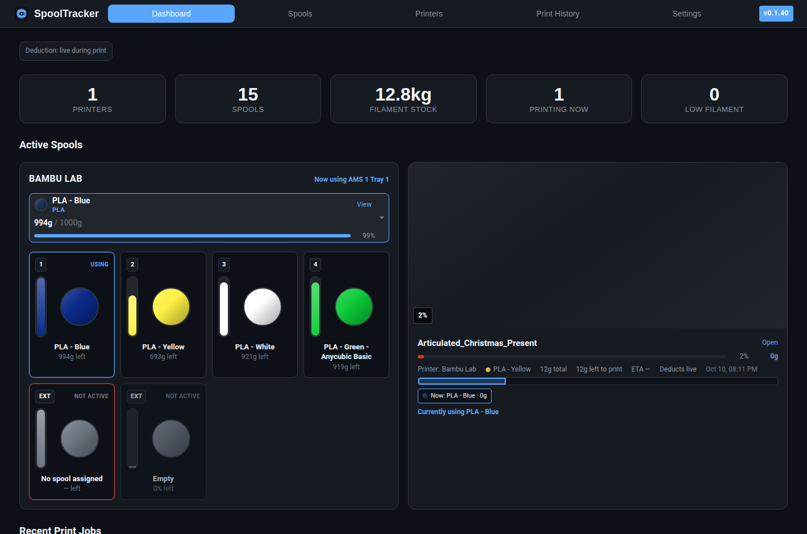
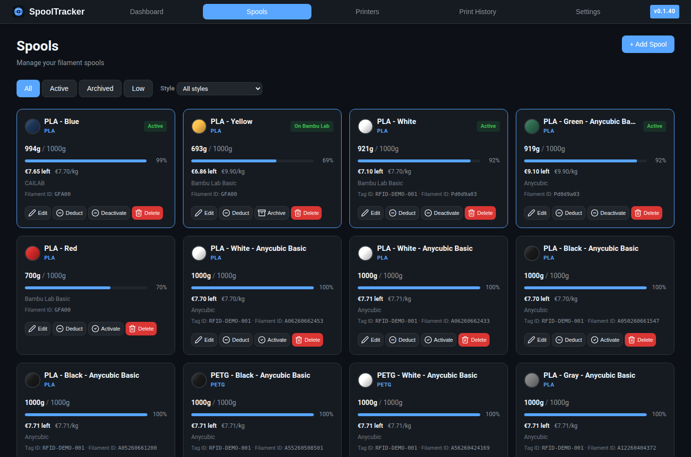
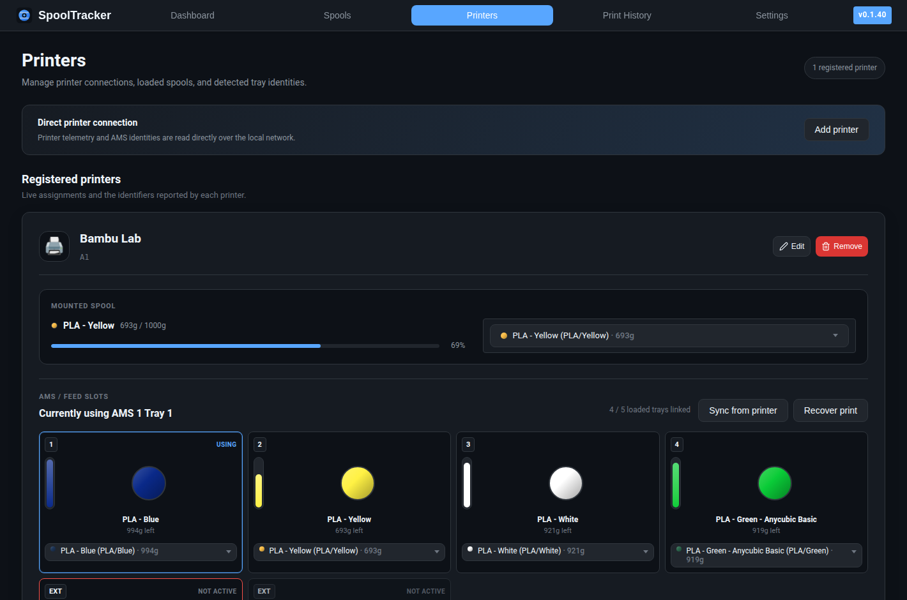
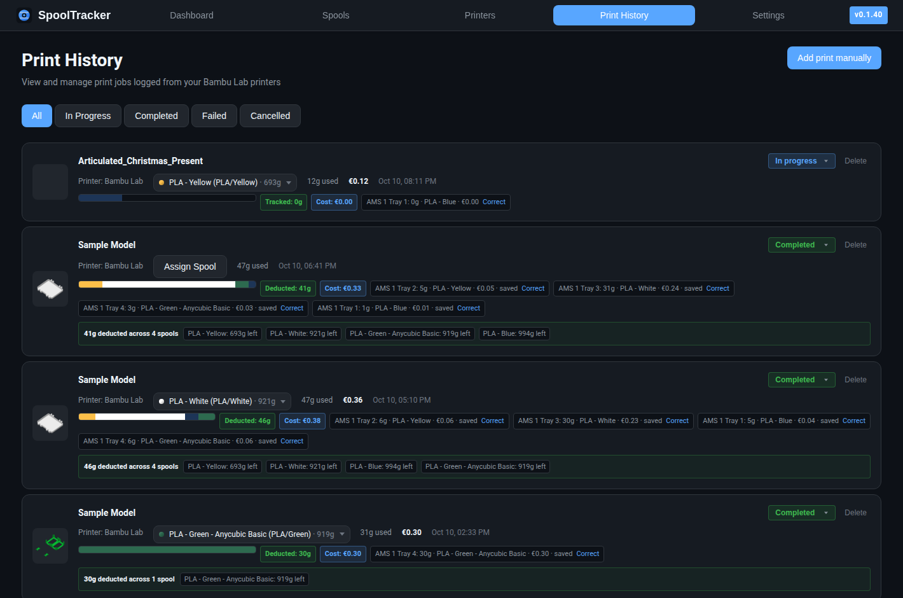
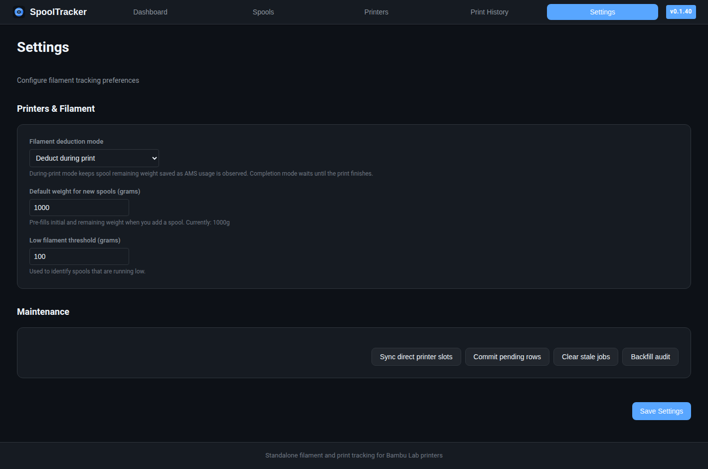

# SpoolTracker

A standalone filament inventory and print tracker. In standalone mode, it connects directly to a configured Bambu Lab printer over the local network; it does not connect to or publish data to Home Assistant.

This is a standalone app. It does not connect to or publish sensors to Home Assistant.

## Features

- **Spool Management** -- Add, edit, archive, and delete filament spools with color, type, weight tracking, and remaining filament progress bars
- **Automatic Print Logging** -- Reads print state, progress, ETA, and model name directly from the printer
- **AMS Multi-Spool Tracking** -- Tracks Bambu Lab AMS trays independently, including active tray changes during multi-color prints
- **Live Filament Deduction** -- Deducts filament from the spool currently active in the printer while the print is running, with an optional completion-only mode
- **Usage Corrections & Audit Log** -- Correct per-spool usage, undo supported corrections, and inspect detailed spool weight history
- **Direct Printer Telemetry** -- Reads AMS slots and identities over MQTT, plus sliced filament estimates from the printer's FTPS cache
- **Dashboard** -- Overview of filament stock, active prints, current active AMS spool, deduction mode, depletion warnings, low filament warnings, and recent print history
- **Maintenance Tools** -- Sync direct printer slots, commit pending usage rows, clear stale jobs, and backfill audit history
- **Readable Printer Dashboard** -- Landscape print previews with job progress, ETA, filament estimate, and per-tray usage below

### UI Preview

Dashboard:



Spools:



Printers:



Print History:



Settings:



## Prerequisites

- A Bambu Lab printer with LAN access enabled and reachable from the SpoolTracker host
- The printer's serial number and LAN access code

## Installation

Use the standalone Docker instructions below. Set the `BAMBU_PRINTER_*` variables for the printer and its matching SpoolTracker printer record.

## Getting Started

### 1. Connect Your Printers

Open the **Printers** tab and confirm the configured printer record and AMS tray assignments.

### 2. Add Your Spools

Go to the **Spools** tab and click **Add Spool**. Enter the filament type, pick a color, and set the initial weight. The spool name is optional -- it auto-generates from the type and color if left blank.

### 3. Start Printing

When a print starts on a connected printer, SpoolTracker automatically creates a print job record. For Bambu Lab AMS printers, the active tray is tracked as the printer changes colors, and filament is deducted from the matching spool for each tray.

If a tray cannot be matched to a spool, the dashboard shows a warning. Assign the tray from the **Dashboard** or **Printers** tab, then subsequent usage will be linked to that spool.

## How It Works

### Automatic Print Detection

The app subscribes to the printer's local MQTT reports. When a print starts:

1. A print job record is created with the project name, thumbnail, and estimated filament usage
2. Printer and AMS tray data are refreshed directly from the printer
3. The active AMS tray is matched to the spool assigned to that tray
4. As progress and active-tray events arrive, per-slot usage is accumulated and saved
5. In live deduction mode, saved usage is immediately subtracted from each spool's `remainingWeight`
6. If no spool can be matched, the dashboard prompts you to assign the active tray

### AMS and Multi-Color Prints

Each AMS tray is represented as a printer slot. Slots store tray metadata from the printer, including tray label, filament type, color, tag UID, tray UUID, weight, and active/empty state.

For multi-color prints, the print job stores one usage row per tray/spool. The **Print History** view shows the per-spool usage split, and the **Dashboard** shows the currently active spool in the printer row. When the printer switches from one color to another, the dashboard switches to the new active tray's spool too.

### Filament Deduction Modes

The deduction mode is configured in **Settings -> Printers & Filament**:

| Mode | Behavior |
|------|----------|
| **Deduct during print** | Default. Each observed usage delta is immediately saved to the spool's remaining weight. |
| **Deduct on completion** | Usage is tracked during the print but only subtracted when the job finishes or pending rows are committed manually. |

The dashboard displays the active mode. In live mode, the stored `remainingWeight` is the source of truth; temporary live-only remaining values are only used when there are pending, not-yet-committed rows.

### Usage Corrections and Audit Log

Spool weight changes are written to an audit log. Open a spool detail page to view:

- The action that changed weight
- Before/after weight
- Delta in grams
- Related print job or usage row
- Metadata for synthetic or correction entries

From **Print History**, use **Correct** on a per-spool usage pill to adjust grams used or move usage to another spool. If that usage was already deducted, the app restores the old deduction and applies the corrected one. Supported correction audit entries can be undone from the spool detail page.

### Dashboard and Printer Views

The dashboard printer row shows the spool from the active AMS tray first, falling back to the legacy loaded spool only when no active tray spool is known. During a print, this means the spool shown in the printer view follows the printer's current color/tray.

Active print cards also show estimated filament left to print. If the currently loaded spool has less remaining filament than the estimated remaining job usage, the card is highlighted.

The **Printers** page includes AMS slots, active/empty state, spool assignment, match suggestions, and a recent printer timeline.

### Maintenance

The **Settings -> Maintenance** tools provide operational fixes without shell access:

- **Sync direct printer slots** -- refresh AMS slot data from the configured printer
- **Commit pending rows** -- subtract tracked but not-yet-deducted usage from spools
- **Clear stale jobs** -- mark old in-progress jobs as failed
- **Backfill audit** -- create synthetic audit entries for existing deducted usage rows that predate the audit log

### Spool Lifecycle

| State | Meaning |
|-------|---------|
| **Active** | Currently loaded in a printer |
| **Inactive** | In stock but not loaded |
| **Archived** | Empty or retired, hidden from the main view |

You can manually archive, reactivate, or deduct filament from any spool via the spool card menu.

## Standalone Docker

Run SpoolTracker independently from Home Assistant. It reads printer state and filament metadata directly from the configured Bambu printer.

### 1. Build the image

```bash
pnpm addon:build
```

### 2. Run the container

Copy `.env.example` to `.env`, configure the direct Bambu connection, then run:

```bash
docker compose up -d --build spooltracker
```

To stop:

```bash
docker compose down
```

Then open **http://localhost:30000** for the SpoolTracker UI.

Optional env vars:

| Variable | Default | Description |
|----------|---------|-------------|
| `PORT` | `3000` | Port the app listens on. |
| `DATABASE_URL` | `file:/data/app.db` | SQLite path or PostgreSQL URL. |
| `LOG_LEVEL` | `info` | `debug`, `info`, `warning`, or `error`. |
| `BAMBU_PRINTER_HOST` | (none) | Printer IP or hostname on the local network. |
| `BAMBU_PRINTER_SERIAL` | (none) | Printer serial number. |
| `BAMBU_PRINTER_ACCESS_CODE` | (none) | Printer LAN access code. |
| `BAMBU_PRINTER_ID` | (none) | Matching printer record ID in SpoolTracker. |

## Development

<details>
<summary>Developer setup instructions</summary>

### Prerequisites

- Node.js 22.22.2 or newer
- pnpm 12.16.1 (the project pins this through `packageManager`)

### Setup

```bash
pnpm install
cp server/config.example.env server/.env
pnpm prisma:generate
pnpm --filter @ha-addon/server db:push
pnpm dev
```

The client runs on `http://localhost:5173` and proxies API calls to the server on port `3001`.

### Build

```bash
pnpm addon:build
```

### Verification

```bash
pnpm --filter @ha-addon/server db:generate
pnpm --filter @ha-addon/types build
pnpm --filter @ha-addon/server type-check
pnpm --filter @ha-addon/client build
pnpm --filter @ha-addon/server test:deduction
```

</details>

## Dependency and install-script security

The project commits `pnpm-lock.yaml` and uses frozen-lockfile installs in Docker builds. npm installs have lifecycle scripts disabled by default. pnpm delays newly published versions for 24 hours, blocks unreviewed dependency scripts, and permits only the exact versions listed in `allowBuilds` in `pnpm-workspace.yaml`. Dependency-provided agent skills are not linked into the checkout. Do not enable scripts for every dependency. Review a package and its script before adding an allowlist entry, then update the lockfile and run `pnpm audit`.

Routine dependency maintenance:

```bash
pnpm update -r
pnpm audit
pnpm build
```

## Security reports

Please report vulnerabilities through [GitHub's private vulnerability reporting](https://github.com/digitalwm/ha-filament-spool-tracker/security/advisories/new) rather than posting exploit details in a public issue.

## License

MIT. See [LICENSE](LICENSE).

## Project guides

- [Contributing](CONTRIBUTING.md)
- [Security policy](SECURITY.md)
